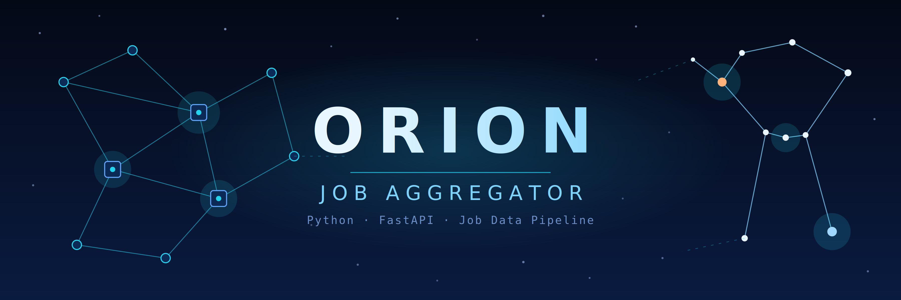
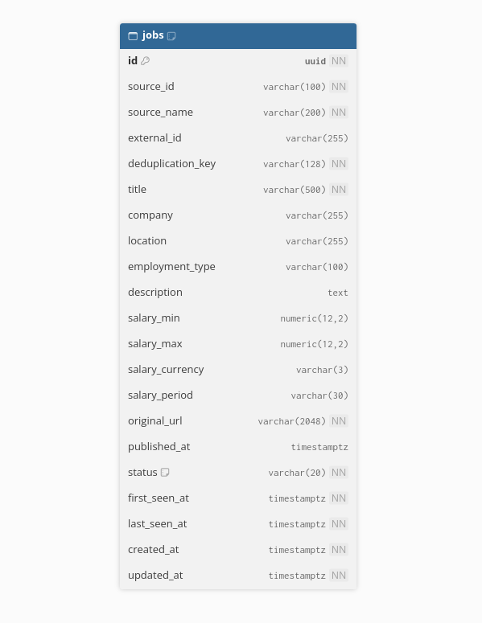

# Orion



[](https://www.python.org/)
[](https://fastapi.tiangolo.com/)
[](https://www.postgresql.org/)
[](https://redis.io/)
[](https://docs.docker.com/compose/)

Orion collects job vacancies from public sources and provides them through a REST API. A background worker updates the data on a schedule.

## Architecture



## Run with Docker

You need Docker and Docker Compose.

1. Create a local environment file:

   ```bash
   cp .env.example .env
   ```

2. Open `.env` and set `POSTGRES_PASSWORD`, `SCRAPE_API_KEY`, and `JWT_SECRET_KEY` to your own values.

3. Create the Docker network and start the services:

   ```bash
   docker network create back_end
   docker compose up --build -d
   ```

The API is available at <http://localhost:8003>. Open <http://localhost:8003/docs> for the interactive API documentation. Check its status at <http://localhost:8003/health>.

## Stop

```bash
docker compose down
```
